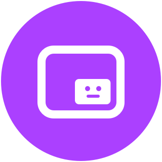
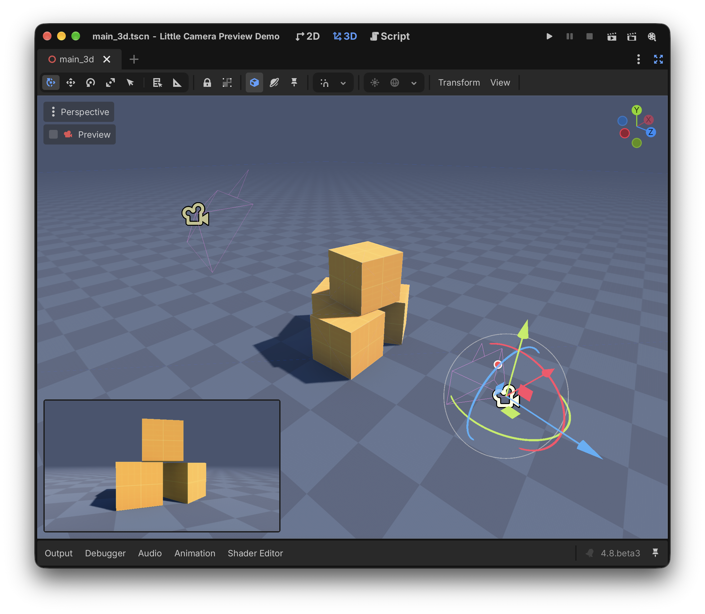

# Little Camera Preview

A Godot editor plugin that shows a picture-in-picture style preview when selecting a 2D or 3D camera.

Install via the [Asset Library](https://godotengine.org/asset-library/asset/2500), or download from [Itch.io](https://anthonyec.itch.io/little-camera-preview) (and pay me a buck, or not).

## Versions

There are two development tracks for the plugin, version 1 and 2. This is because in Godot 4.8 there was a [major change](https://github.com/godotengine/godot/pull/113051) to how editor plugins work.

For now, both versions of the plugin are supported, and where possible, features and fixes will be back ported.

| Plugin version | Godot version           |
| -------------- | ----------------------- |
| `v1.x`         | Godot `v4.3` to `v.4.7` |
| `v2.x`         | Godot `v4.8` and above  |

## Installation

If you've downloaded this manually, do the following:

- Download the correct release for version of Godot you are using.
- Find the `addons` folder in your project files, or create it if it doesn't exist yet.
- Move the folder `addons/anthonyec.camera_preview` to your project's `addons` folder.
- Enable Little Camera Preview under `Project > Project Settings > Plugins`

## Licence

Licensed under the MIT license, see [LICENSE](./LICENSE) for more information.
